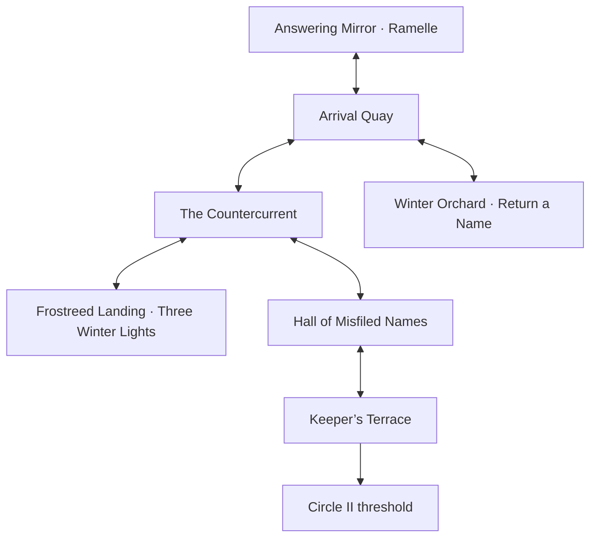

# The Pale Gate

The first Circle is a quiet winter transit district. Snow sits on the pines above the quay and light catches on the water. True Light and Dawn Bloom soldiers wait on the same bank. Their uniforms are worn and one has a bandaged arm. Aimon says it looks like the hills above Civeton. Vantis explains that there are worse places to wait.

## Main route

- **Arrival Quay.** Meet Vantis Eldrin and two dead soldiers. The road east leads to the ferry. The orchard path branches south from the central square. Aimon can rest and use reserve care at the quay shelter or return through the mirror.
- **The Countercurrent.** Read three riddles. On the water, choose one of three lanes at each fork and ring its chain while the gate is aligned. The ferry moves across a winter backdrop, and alignment has a visual cue, chime and status text. The slow crossing gives longer windows. Pause or a loss of focus stops the current. A wrong answer or missed window returns the player to the near bank without losing a life. Once the far bank is reached, the return crossing is direct. The Toll Bailiff challenges the player before they can reach the hall.
- **Hall of Misfiled Names.** Cross-reference three intake dockets with the ferry receipt. Work out which ferry each token permits, when it sailed, and which stamps record intake and boarding. Evidence stays in the Expedition Journal. Incorrect submissions explain the conflicting detail. The Ledger Hound offers an optional second demon fight.
- **Keeper’s Terrace.** Hugh FitzAlan, the Keeper of Names, fights with six Abyssals at levels 105–110, led by Trucepoe and ending with Pandemne, using the locked WRD-01 roster. The live learnsets supply four legal moves per slot. STATUS / SPEED / STATUS are allocated to slots 1, 2 and 6. The native Namefog field boosts Ghost damage by 50% and halves Psychic damage for both sides. A temporary field suspends it. Victory opens the inner arch and unlocks the Underway Relay between the terrace and the quay shelter. The playable chapter ends at the Circle II threshold.

## Side routes

| Route | Mission | Resolution |
| --- | --- | --- |
| Winter Orchard | **Return a Name** | Compare the bell tag, feeding bowl and watch roster. Return Lark’s name to the soldier. This records the memorial, brings Lark into the scene, and awards two Fortified Rations once. |
| Frostreed Landing | **Three Winter Lights** | Each lever flips its own lamp and its neighbours. Light all three to reveal the flood marker. Rimebun and Frostrill can then be tracked as repeatable wild encounters using normal befriending rules. |

## Art and runtime

The six 48×32-tile maps have individual winter environments. The quay, river, archive and terrace retain separate silhouettes and navigable corridors. The actor set includes the two soldiers, Bailiff, Ledger Hound, Keeper, and Vantis’s twelve-frame directional walk atlas. The world props include the ledger tablet, bell, bowl, lantern buoy, ferry, flood marker and arch. Trainer portraits and the battle backdrops share the environment palette. Rimebun, Frostrill and Lark use the existing Abyssal artwork.

Source artwork and generation briefs are in `art-library/pale-gate/`. Runtime maps and sprites are under `dist/assets/finale/` and the portraits under `dist/assets/`. All runtime additions are registered for offline use. The Vantis mirror introduction retains the established save keys and character ID.
